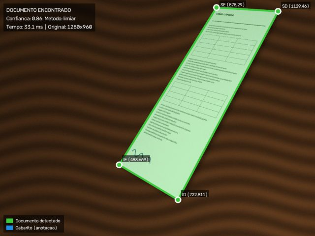
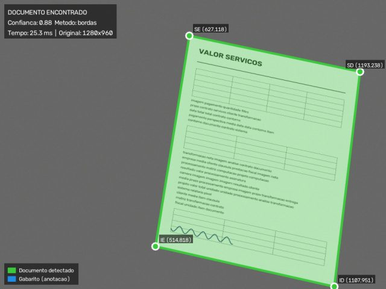
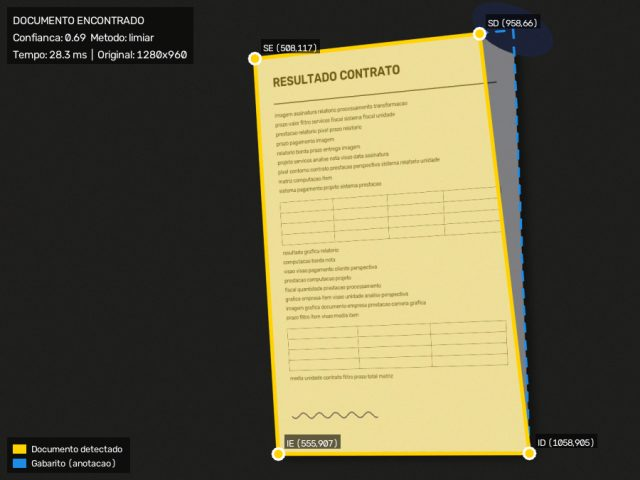
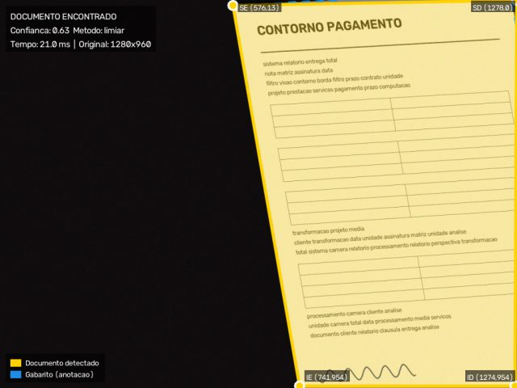
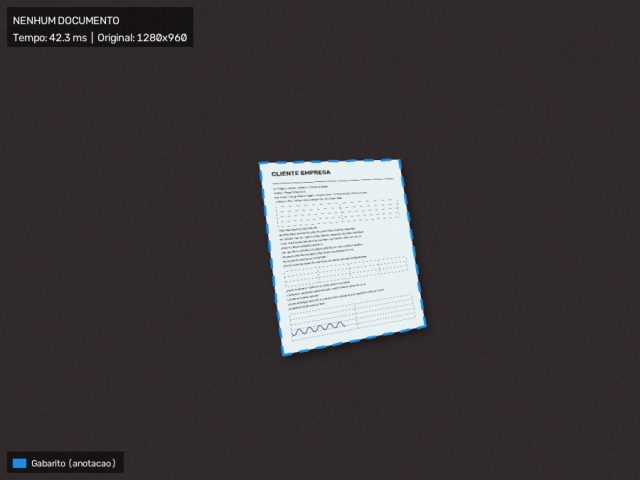

# 📄 Scanner de Documentos com Visão Computacional

Projeto Final de **Computação Gráfica**: Sistema Interativo de Visão Computacional.
Prof. Pedro Cândido.

A aplicação recebe uma **foto, um vídeo ou a webcam**, localiza a folha de papel na cena,
corrige a perspectiva e entrega o documento "escaneado". Cada etapa da análise aparece
graficamente na interface.



---

## 1. Problema e público

Fotos de documentos tiradas com o celular saem **inclinadas, em perspectiva, com fundo da mesa e
iluminação irregular**. Isso dificulta arquivar, imprimir ou aplicar OCR. Quem sente esse
problema: estudantes que entregam listas fotografadas, pequenos escritórios e setores de cadastro
que recebem documentos por foto, e qualquer pessoa sem scanner.

| | |
|---|---|
| **Entrada** | imagem (JPG/PNG/BMP/WEBP/TIFF), vídeo (MP4/AVI/MOV/MKV/WEBM), foto da câmera do navegador ou webcam ao vivo |
| **Saída** | contorno e cantos do documento sobre a imagem, documento retificado (colorido, cinza ou preto e branco) para download, confiança, tempos e métricas |
| **Resultado esperado** | IoU ≥ 0,90 entre o contorno detectado e o real em fotos com contraste razoável, em tempo compatível com vídeo (> 15 FPS) |
| **Fora do escopo** | páginas curvas (livros), vários documentos na mesma foto, OCR (veja *Limitações*) |

## 2. Funcionalidades

* 6 fontes de entrada: imagem de exemplo, upload de imagem, foto do navegador, vídeo de exemplo,
  upload de vídeo e **webcam ao vivo**.
* Pipeline clássica de visão computacional (OpenCV), explicável etapa a etapa.
* **19 parâmetros** ajustáveis na barra lateral, sem editar código, além do botão "Restaurar padrões".
* Visualização em camadas: fundo escurecido, máscara translúcida colorida pela confiança, contorno,
  cantos com coordenadas originais, candidatos descartados, gabarito, HUD e legenda.
* Aba **Etapas da pipeline**: as 8 imagens intermediárias e a tabela de candidatos com a pontuação.
* Aba **Comparação lado a lado**: original | bordas | detecção | resultado.
* Vídeo/câmera em tempo real com **suavização temporal (EMA)**, persistência e FPS.
* Aba **Métricas**: roda a avaliação do conjunto anotado com os parâmetros atuais.
* Tratamento de erros: arquivo vazio, corrompido ou com extensão errada, imagem minúscula ou enorme,
  vídeo ilegível, câmera ausente ou ocupada, nenhum documento, detecção pouco confiável.

## 3. Instalação e execução

Requisitos: **Python 3.13** (testado com 3.13.5, Windows 10). Não precisa de GPU nem baixar pesos.

```bash
# 1. criar e ativar o ambiente virtual
python -m venv .venv
.venv\Scripts\activate            # Windows
# source .venv/bin/activate       # Linux/macOS

# 2. instalar dependências
pip install -r requirements.txt

# 3. executar a aplicação (abre em http://localhost:8501)
streamlit run app.py
```

Outros comandos:

```bash
python scripts/gerar_amostras.py   # (re)gera data_samples/ (semente fixa = 42)
python scripts/avaliar.py          # recalcula as métricas em docs/resultados/
python -m pytest                   # 16 testes automatizados
```

### Versões das principais dependências

| Pacote | Versão | Uso |
|---|---|---|
| Python | 3.13.5 | linguagem |
| opencv-python | 5.0.0.93 | processamento de imagem e visão computacional |
| numpy | 2.5.5 | matrizes e geometria |
| streamlit | 1.67.0 | interface |
| pandas | 3.1.1 | tabelas e gráficos da interface |
| pillow | 13.0.0 | dependência de imagem do Streamlit |
| pytest | 9.2.0 | testes |

## 4. Como usar

1. Na barra lateral, escolha a **fonte** (comece por "Imagem de exemplo").
2. Ajuste os **parâmetros**; o resultado é recalculado a cada alteração.
3. Na aba **Análise**: o resultado, as etapas da pipeline e a comparação. Baixe o documento em PNG.
4. Em vídeo, clique em **▶ Processar vídeo**. Na câmera ao vivo, use o botão **Ligar câmera**;
   ao desligar, aparece o último documento capturado.
5. Na aba **Métricas**, clique em **Avaliar imagens com os parâmetros atuais** para medir a
   qualidade dos parâmetros escolhidos.

Dica de demonstração: em `dificil_06_pequeno.jpg` o documento não é encontrado (ocupa < 10% da
foto). Reduza **Área mínima do documento** para 0,04 e ele passa a ser detectado.

### Parâmetros

| Grupo | Parâmetro | Padrão | Efeito |
|---|---|---|---|
| Pré-processamento | Altura de processamento | 500 px | resolução usada na detecção (velocidade × detalhe) |
| | Equalizar contraste (CLAHE) | ligado | ajuda com sombras |
| | Filtro gaussiano | 5 | suaviza ruído e texto |
| | Limiares do Canny | automáticos | manual: (50, 150) |
| | Fechamento morfológico | 5 | liga bordas interrompidas |
| Detecção | Método | automático | bordas (Canny), limiar (Otsu) ou ambos |
| | Tolerância da aproximação poligonal | 0,02 | fração do perímetro no `approxPolyDP` |
| | Área mínima do documento | 0,10 | fração da imagem |
| | Confiança mínima | 0,35 | abaixo disso o resultado é descartado |
| | Refinamento subpixel | ligado | `cornerSubPix` na resolução original |
| Saída | Documento retificado | colorido | colorido, cinza ou P&B (limiar adaptativo) |
| | Rotação da saída | 0° | 0/90/180/270° |
| | Opacidade da máscara | 0,35 | transparência da camada |
| | Mostrar candidatos | desligado | contornos descartados em cinza |
| | Largura de exibição | 900 px | tamanho na tela |
| Vídeo | Suavização (alfa da EMA) | 0,5 | 1 = sem suavização |
| | Persistência | 5 quadros | mantém o último contorno se a detecção falhar |

## 5. Arquitetura e estrutura de pastas

```
visao-computacional/
├── app.py                      # interface Streamlit (só entrada, parâmetros e exibição)
├── src/
│   ├── config.py               # Parametros (dataclass) + caminhos relativos do projeto
│   ├── pipeline.py             # orquestra todas as etapas para uma imagem/quadro
│   ├── geometry.py             # mapeamento de coordenadas, ordenação, perspectiva, IoU
│   ├── acquisition/loader.py   # leitura e validação de imagem, vídeo e câmera
│   ├── preprocessing/ops.py    # resize, cinza, CLAHE, gauss, Canny, morfologia, Otsu
│   ├── models/
│   │   ├── document_detector.py  # contornos → quadriláteros → confiança; refinamento subpixel
│   │   └── smoothing.py          # EMA + persistência para vídeo
│   ├── visualization/draw.py   # camadas, transparência, HUD, legenda, mapa de calor, comparação
│   └── metrics/
│       ├── quality.py          # IoU, erro de canto, VP/FP/FN, nitidez
│       ├── performance.py      # cronômetro por etapa, FPS
│       └── avaliacao.py        # protocolo de avaliação (usado pelo script e pela interface)
├── scripts/
│   ├── gerar_amostras.py       # conjunto sintético com gabarito
│   └── avaliar.py              # gera docs/resultados/
├── data_samples/
│   ├── imagens/                # 30 imagens + anotacoes.json (gabarito dos cantos)
│   ├── videos/                 # vídeo de 150 quadros + gabarito por quadro
│   ├── invalidos/              # arquivos para demonstrar o tratamento de erros
│   └── reais/                  # (opcional) fotos próprias, ignoradas pelo Git
├── tests/                      # testes pytest (geometria, pipeline, erros, suavização)
├── docs/
│   ├── pipeline.md             # detalhamento técnico de cada etapa
│   ├── diario_desenvolvimento.md
│   └── resultados/             # métricas (CSV, JSON, Markdown) e imagens de exemplo
├── requirements.txt
├── pytest.ini
└── .gitignore
```

A interface não contém lógica de visão: ela monta um `Parametros` e chama `pipeline.processar`.
O mesmo código é usado pelos testes e pela avaliação, o que garante que as métricas documentadas
vêm do código que roda na demonstração. Todos os caminhos são relativos à raiz do projeto
(`src/config.py`).

## 6. Pipeline (resumo)

| Etapa | O que faz | Código |
|---|---|---|
| 1. Aquisição | imagem, vídeo, câmera do navegador, webcam | `acquisition/loader.py` |
| 2. Validação | extensão, vazio, corrompido, tamanho, câmera | `acquisition/loader.py`, `Parametros.validar` |
| 3. Pré-processamento | **redimensionamento com proporção → cinza → CLAHE → gaussiano → Canny → fechamento morfológico**; Otsu em paralelo | `preprocessing/ops.py` |
| 4. Análise visual | contornos → `approxPolyDP` → quadriláteros convexos → pontuação de confiança | `models/document_detector.py` |
| 5. Interpretação | ordenar cantos, mapear para a resolução original, refinamento subpixel, EMA no vídeo | `geometry.py`, `models/` |
| 6. Representação | camadas com transparência, contorno, cantos, HUD, legenda, homografia, mapa de calor | `visualization/draw.py`, `geometry.py` |
| 7. Interface | Streamlit | `app.py` |
| 8. Avaliação | IoU, erro de canto, FP/FN, tempo, FPS, tremor | `metrics/` |
| 9. VLM | **não utilizado** (seção 10) | — |

A justificativa de cada operação, a fórmula da confiança e a lista dos **10 itens de Computação
Gráfica implementados** (o enunciado pede 4) estão em **[docs/pipeline.md](docs/pipeline.md)**.

## 7. Métricas e resultados

Conjunto de teste: **30 imagens sintéticas com gabarito exato** (12 fáceis, 8 médias, 6 difíceis e
4 sem documento) e um **vídeo de 150 quadros** com gabarito por quadro. A seção 9 explica por que o
conjunto é sintético.

* **Qualidade**: IoU entre o quadrilátero detectado e o real (acerto se IoU ≥ 0,90); erro médio
  de canto em px e em % da diagonal; falsos positivos e negativos; precisão e recall; no vídeo,
  *tremor* (movimento dos cantos que não corresponde ao movimento real do documento).
* **Desempenho**: tempo por etapa (ms, média e p95) e FPS.

Resultados com os parâmetros padrão (`python scripts/avaliar.py`, CPU de notebook, sem GPU):

| Categoria | Imagens | Acertos (IoU ≥ 0,9) | FN | FP | IoU médio | Erro de canto |
|---|---|---|---|---|---|---|
| Fácil | 12 | **12** | 0 | 0 | 0,996 | 0,06% da diagonal |
| Médio | 8 | **8** | 0 | 0 | 0,998 | 0,03% |
| Difícil | 6 | 4 | 1 | 0 | 0,787 | 1,22% |
| Sem documento | 4 | — (4 VN) | — | **0** | — | — |
| **Total** | 30 | **24/26 (92,3%)** | 1 | **0** | 0,948 | 0,29% |

* Precisão 96% (o único erro é um contorno impreciso, não um falso positivo); tempo médio de
  ~20–30 ms por imagem 1280×960.
* **Comparação de configurações**: o modo automático (bordas + limiar) supera cada método isolado;
  desligar o CLAHE causa mais um falso negativo; o refinamento subpixel reduz o erro de canto de
  0,54% para 0,29% da diagonal.
* **Vídeo**: 100% dos quadros com documento, ~35 FPS de processamento (~18 FPS na interface,
  incluindo a exibição). Com alfa 0,5 o tremor cai de 2,41 para 1,91 px, mas o erro médio sobe
  de 3,3 para 8,5 px por causa do atraso. É o compromisso clássico entre estabilidade e latência,
  e por isso o alfa é configurável.

Tabelas completas (por imagem, por método, por alfa): **[docs/resultados/RESULTADOS.md](docs/resultados/RESULTADOS.md)**.

## 8. Acertos, erros e limitações

| Caso | Resultado | Explicação |
|---|---|---|
|  Fundo claro, baixo contraste | ✅ IoU 0,999 | o CLAHE realça a borda fraca; sem CLAHE esse tipo de caso falha |
|  Canto coberto por um objeto | ⚠️ IoU 0,931 | o canto é estimado pelo fecho convexo; uma faixa lateral fica de fora (área escurecida) e o erro de canto chega a 17 px |
|  Documento cortado pela foto | ❌ IoU 0,835 | a borda da foto vira lado do documento; a parte fora da imagem não pode ser recuperada |
|  Documento pequeno (< 10% da foto) | ❌ falso negativo | filtrado pela área mínima; com 0,04 é detectado (25/26 acertos), ao custo de mais risco de falso positivo |

Outras limitações conhecidas:

* **Dados sintéticos**: o conjunto anotado não tem a variedade de fotos reais (reflexos, papel
  amassado, texturas complexas). Os números acima são um limite otimista; veja
  `data_samples/reais/LEIAME.md` para avaliar fotos próprias.
* Páginas **curvas** (livro aberto) não são quadriláteros: a retificação por homografia não as
  "desentorta".
* Fundos com **retângulos claros grandes** (folhas, telas, caixas) podem competir com o documento;
  na prática, aparecem como candidato de menor confiança.
* Apenas **um documento** por imagem.
* Não há **OCR**: o resultado é a imagem retificada, pronta para um OCR externo.

## 9. Ética, privacidade e fontes dos dados

* **Todas as imagens e o vídeo de `data_samples/` são sintéticos**, gerados por
  `scripts/gerar_amostras.py`: texto aleatório desenhado com OpenCV, sem pessoas, rostos, nomes ou
  documentos reais. Não há questões de autorização ou de direitos de imagem.
* O gabarito é exato porque a posição do documento é conhecida na geração (homografia definida
  pelo script).
* A aplicação roda **100% local**: nenhuma imagem é enviada para serviços externos.
* Fotos reais devem ser tiradas pela própria equipe, sem dados pessoais. A pasta
  `data_samples/reais/` é ignorada pelo Git por padrão.

## 10. VLM

**Não utilizado.** O problema tem saída geométrica verificável (4 cantos) e é resolvido com
precisão pela pipeline clássica. Um VLM acrescentaria custo, latência e risco de alucinação sem
ganho mensurável para esta tarefa.

## 11. Fontes, créditos e licenças

| Recurso | Licença | Uso |
|---|---|---|
| [OpenCV](https://github.com/opencv/opencv) | Apache 2.0 | todas as operações de imagem |
| [NumPy](https://numpy.org/) | BSD-3 | matrizes |
| [Streamlit](https://github.com/streamlit/streamlit) | Apache 2.0 | interface |
| [pandas](https://pandas.pydata.org/) | BSD-3 | tabelas da interface |
| [Pillow](https://python-pillow.org/) | MIT-CMU | dependência do Streamlit |
| [pytest](https://pytest.org/) | MIT | testes |

Referências técnicas:

* Tutoriais de processamento de imagem do OpenCV: https://docs.opencv.org/5.0/py_tutorials/py_imgproc/py_table_of_contents_imgproc.html
  (Canny, contornos, `approxPolyDP`, morfologia, limiarização, `getPerspectiveTransform`).
* Canny, J. *A Computational Approach to Edge Detection*. IEEE TPAMI, 1986.
* Otsu, N. *A Threshold Selection Method from Gray-Level Histograms*. IEEE TSMC, 1979.
* Douglas, D.; Peucker, T. *Algorithms for the reduction of the number of points required to
  represent a digitized line*. 1973 (base do `approxPolyDP`).
* Zuiderveld, K. *Contrast Limited Adaptive Histogram Equalization*. Graphics Gems IV, 1994 (CLAHE).
* A regra de limiares automáticos do Canny (0,67× e 1,33× a mediana) é uma heurística conhecida
  da comunidade OpenCV.
* Documentação do Streamlit: https://docs.streamlit.io/

Nenhum código de repositório externo foi copiado. Modelos ou pesos pré-treinados não são usados.

## 12. Uso de ferramentas de inteligência artificial

| Ferramenta | Finalidade | Partes afetadas |
|---|---|---|
| Claude Code (modelo Claude Opus 5.5, Anthropic) | geração da versão inicial do código, dos testes, do gerador de dados sintéticos e da documentação; depuração de desempenho (a camada de visualização caiu de ~120 ms para ~11 ms por quadro) | todo o repositório na versão inicial |

**Como os resultados foram verificados** (a equipe deve completar e manter atualizado):

* testes automatizados (`python -m pytest`: 16 testes);
* avaliação quantitativa com gabarito (`scripts/avaliar.py`);
* execução manual da interface em todos os modos de entrada;
* _[equipe: descrever a revisão feita por cada integrante, o que foi alterado e o que foi testado com fotos reais]_.

## 13. Equipe e contribuições

| Integrante | Responsabilidades | Arquivos principais |
|---|---|---|
| Mateus Costa Guimarães | coordenação, integração da pipeline, configuração e repositório | `src/pipeline.py`, `src/config.py`, `requirements.txt`, `.gitignore` |
| Hiago | aquisição e validação das entradas (imagem, vídeo, câmera, arquivos inválidos) | `src/acquisition/`, `data_samples/invalidos/` |
| Heithor | pré-processamento (redimensionamento, CLAHE, filtro, Canny, morfologia, Otsu) | `src/preprocessing/` |
| Daniel | detecção do documento, pontuação de confiança, refinamento subpixel e suavização no vídeo | `src/models/` |
| John Lucas | geometria e representação gráfica (coordenadas, perspectiva, camadas, mapa de calor) | `src/geometry.py`, `src/visualization/` |
| Lucas Oliveira | interface Streamlit (fontes de entrada, parâmetros, abas, mensagens de erro) | `app.py` |
| Pedro Henrique | métricas, avaliação, dados sintéticos e testes automatizados | `src/metrics/`, `scripts/`, `tests/` |

Documentação, apresentação e vídeo de segurança: toda a equipe. Os commits de cada integrante
estão no histórico do Git (`git log --author="<nome>"`).

Planejamento e evolução: **[docs/diario_desenvolvimento.md](docs/diario_desenvolvimento.md)**.
